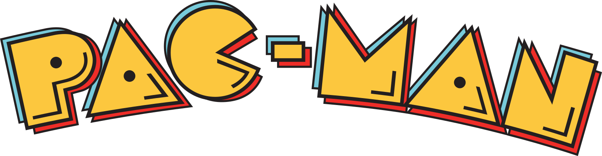

# 🎮 Pacman Game

A simple Pacman game project focused on understanding the fundamentals of game development, screen positioning, map rendering, and random enemy movement.

## 📌 About the Project

This project explores the basic logic and functions used to create a Pacman-style game. It provides a practical introduction to handling console output, managing positions on a game map, displaying collectibles, and generating random enemy movements.

## 🕹️ Game Mechanics & Core Functions

### 1. `gotoxy()`
Moves the cursor to a specified position on the screen. This allows game elements to appear at particular rows and columns.

### 2. `food()`
Displays food items on the game map that act as collectible points for the player. It uses row and column positions to determine where the food appears.

### 3. `displayMap()`
Renders the game map on the screen, providing the layout in which the player, food, and enemies interact.

### 4. `system("cls")`
Clears the console screen to refresh the display during gameplay. This command is commonly used in Windows-based C/C++ console applications.

### 5. `srand()` and `time()`
Initialize the random number generator using the current time. This helps produce varied random sequences, which can be used to determine enemy movements.

## 🛠️ Concepts Covered

- Console-based game development
- Cursor positioning and screen manipulation
- Map rendering using rows and columns
- Collectible items and scoring concepts
- Random number generation
- Basic game logic and interaction

## 🎯 Project Objective

The goal of this project is to understand how simple programming functions work together to build the foundation of a Pacman-style game.

---

*Built as a learning project to explore programming fundamentals through game development.*
